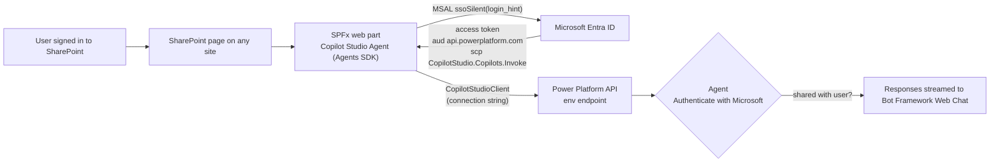
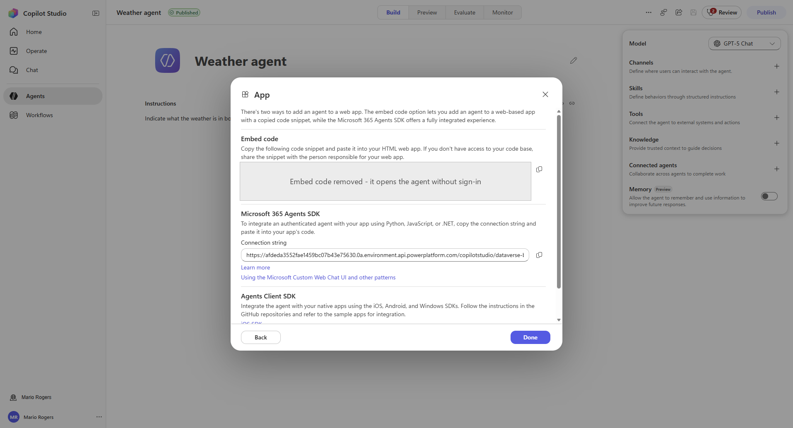
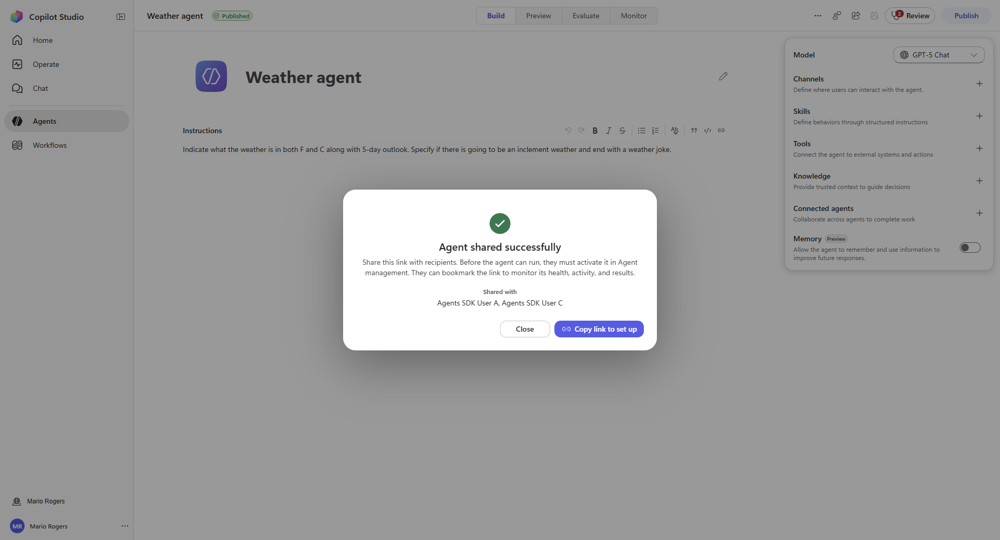
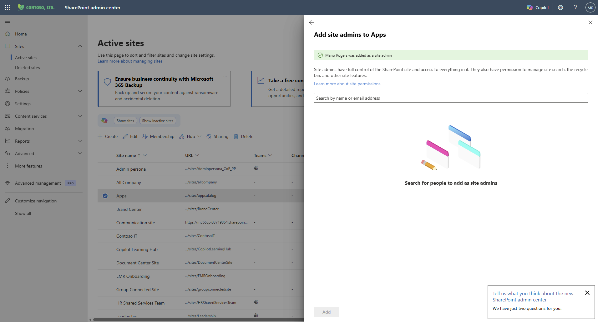
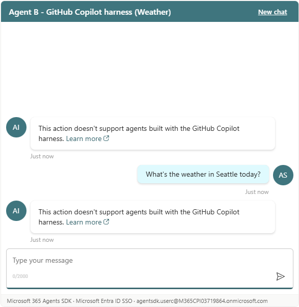
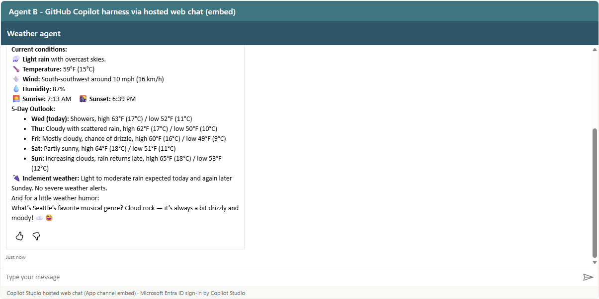
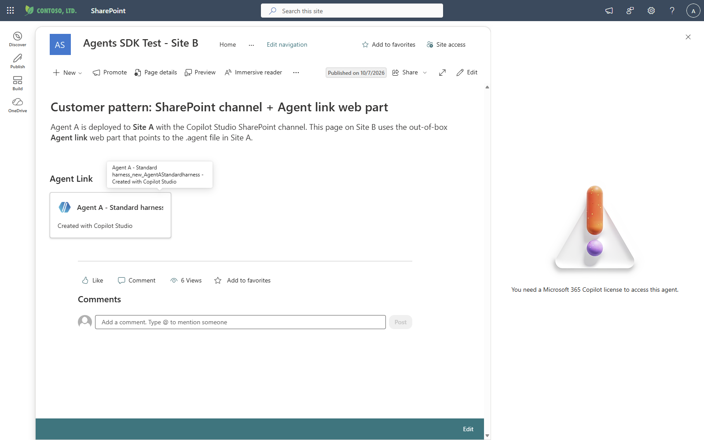
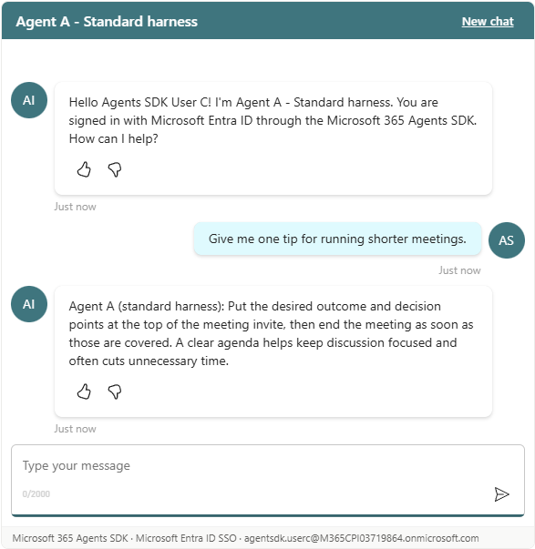
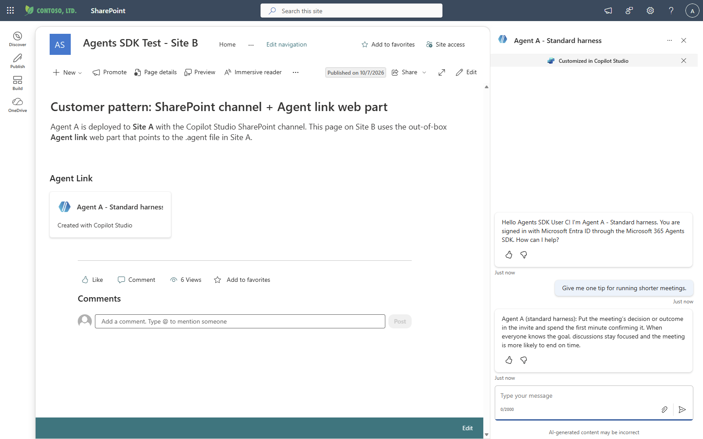

# Authenticated Copilot Studio agents on many SharePoint sites with the Microsoft 365 Agents SDK

> Validated end-to-end on **7 Oct 2026** in tenant `M365CPI03719864` with Copilot Studio (preview), SharePoint Online,
> SPFx 1.21.1, `@microsoft/agents-copilotstudio-client` 1.9.1, MSAL.js 4.30 and Bot Framework Web Chat 4.19.1.
> Every step below was executed and every result in [section 7](#7-test-matrix-and-results) was produced by an automated
> Edge test run, not inferred.
>
> Companion material: [tutorial](Agents-SDK-SharePoint-Tutorial.md) ·
> [use cases and test scenarios](Agents-SDK-SharePoint-Use-Cases-and-Test-Scenarios.md) ·
> [test plan (Excel)](Agents-SDK-SharePoint-Test-Plan.xlsx) ·
> [tutorial + test scenarios (web page)](https://patmeh1.github.io/copilot-studio-agents-sdk-sharepoint/Agents-SDK-SharePoint-Tutorial-and-Test-Scenarios.html) ·
> [customer use-case page (web page)](https://patmeh1.github.io/copilot-studio-agents-sdk-sharepoint/Agents-SDK-SharePoint-Use-Case.html) ·
> [deck](Copilot-Studio-Agents-SDK-SharePoint.pptx) · [raw results](test-results)

## 1. TL;DR

| Question | Answer |
|---|---|
| Can one authenticated agent be published to **many SharePoint sites** with the **Microsoft 365 Agents SDK**? | **Yes**, for agents on the **standard harness**. One SPFx package + one Entra app registration serve every site in the tenant; each page only needs the agent's *connection string*. |
| Does the user get **single sign-on** and does the agent know **who** the user is? | **Yes.** MSAL `ssoSilent` reuses the SharePoint sign-in (no prompt, even with MFA). The agent greeted every tester by name (`Hello Agents SDK User A!`). |
| Does Copilot Studio **sharing** still control who can chat? | **Yes.** Users the agent is not shared with get `You don't have access to talk to this bot, contact the owner.` on every site. |
| Does SharePoint permission matter? | It controls **page access only** (Visitor is enough). It never grants agent access, and agent access never grants site access. |
| Does it work for agents built with the **GitHub Copilot harness** (the original Weather agent)? | **No (not yet).** Copilot Studio answers every Agents SDK request with `This action doesn't support agents built with the GitHub Copilot harness.` - matching Microsoft's note that the client library supports standard-harness agents only. |
| What about the **embed code** of the GitHub Copilot harness agent? | It renders and answers, **but it is not authenticated**: it answered users the agent was *not* shared with and even a signed-out browser. Treat it as public (see [section 10](#10-security-findings-and-recommendations)). |
| Can SPFx's built-in token provider (`AadTokenProvider`) be used? | **No.** It cannot obtain `CopilotStudio.Copilots.Invoke` (first-party preauthorization, tracked in [sp-dev-docs#10775](https://github.com/SharePoint/sp-dev-docs/issues/10775)). The web part uses **MSAL.js with its own SPA app registration** instead. |
| How does this compare with the **SharePoint channel + Agent link** pattern? | Same runtime, same sharing/licensing behaviour - but Agent link depends on the `.agent` file in the deployment site (users need Read on it). The Agents SDK web part has **no primary-site dependency** (verified: a shared user without Site A access chats via the SDK web part but is blocked via Agent link). See [section 9](#9-customer-pattern-sharepoint-channel--agent-link-web-part-vs-agents-sdk-web-part). |

## 2. Architecture



* **One SPA app registration** (`Copilot Studio Agents SDK - SharePoint`) with redirect URI = the SharePoint origin
  (`https://<tenant>.sharepoint.com`). All sites share that origin, so it covers every site.
* **One SPFx package** deployed tenant-wide ("Enable this app and add it to all sites"). The web part is in the toolbox of every site.
* **Per page/instance**: paste the agent's *Microsoft 365 Agents SDK connection string*. Different pages can host different agents.
* The web part also has an **embed mode** (Copilot Studio hosted web chat) used here only to compare the GitHub Copilot harness path.

## 3. Variables

Copy [`scripts/variables.sample.ps1`](../scripts/variables.sample.ps1) to `variables.ps1` and fill it in.

| Variable | Meaning | Where to find it | Value used in the test |
|---|---|---|---|
| `$TenantDomain` / `$TenantId` | Entra tenant | Entra admin center > Overview | `M365CPI03719864.onmicrosoft.com` / `c13b5dfa-60e0-4b6d-bfad-5a8f9b8e5c0d` |
| `$SharePointRootUrl` | SharePoint origin (also the SPA redirect URI) | | `https://m365cpi03719864.sharepoint.com` |
| `$AppCatalogUrl` | Tenant app catalog | `<root>/_api/SP_TenantSettings_Current` | `.../sites/appcatalog` |
| `$EnvironmentId` | Power Platform environment | Copilot Studio > agent > Settings > Advanced > Metadata | `afdeda35-52fa-e145-9bc0-7b43e756300a` |
| `$AgentSchemaName` | Agent schema name | same place, or the end of the connection string | `new_AgentAStandardharness` |
| `$AgentConnectionString` | Agents SDK connection string | Channels > **Web app** (standard UI) or Channels > **App** (new UI) > *Microsoft 365 Agents SDK* | `https://afdeda3552fae1459bc07b43e75630.0a.environment.api.powerplatform.com/copilotstudio/dataverse-backed/authenticated/bots/new_AgentAStandardharness/conversations?api-version=2022-03-01-preview` |
| `$AppDisplayName` / `$AppClientId` | SPA app registration used by MSAL | output of `New-AgentsSdkSpaApp.ps1` | `Copilot Studio Agents SDK - SharePoint` / `1f06ba87-8706-4216-bb08-f8d10c3118cf` |
| `$Node22Path` | Node.js 22 folder (SPFx 1.21.1 needs `>=22.14 <23`) | | portable Node 22.23.3 |
| `$PackageVersion` | `.sppkg` version - increase on every update | | `1.0.3.0` (1.0.1.0 for the matrix run, 1.0.3.0 after the sign-in fix) |
| `$SiteUrls` | Sites that will host the agent | | `/sites/AgentsSDK-SiteA`, `-SiteB`, `-SiteC` |

> The connection string host is the environment ID without dashes with a `.` before the last two characters
> (`afdeda35-52fa-e145-9bc0-7b43e756300a` -> `afdeda3552fae1459bc07b43e75630.0a`). Prefer copying it from Copilot Studio.

## 4. Prerequisites and roles

| Need | Why | Used in the test |
|---|---|---|
| Copilot Studio maker access to the environment | create / publish / share the agent | MarioR |
| Entra: permission to register applications | SPA app registration | allowed for all users in this tenant |
| Entra: tenant-wide consent for `Power Platform API / CopilotStudio.Copilots.Invoke` (delegated, user-consentable) | silent SSO without consent prompts | granted by MarioR (User Admin + AI Admin + SharePoint Admin) with `az ad app permission admin-consent`. Normally Cloud Application Administrator or higher. |
| SharePoint Administrator **and** site admin of the app catalog site | upload/enable the `.sppkg` | MarioR had to add himself as app catalog site admin |
| Workstation | build | Windows, PowerShell 7, Azure CLI 2.91, Node 22.23.3 (portable; system Node 26 is too new for SPFx 1.21.1) |
| End-user licenses | open SharePoint and chat | testers only had **Microsoft 365 E5 (no Teams)** - no Copilot Studio or Microsoft 365 Copilot license was required to chat through the Agents SDK. Agent messages consume the tenant's Copilot Studio capacity. |

## 5. Step-by-step

### Step 1 - Build and publish a standard-harness agent with Microsoft authentication

1. Copilot Studio home > **Other ways to build** > **Agent (Standard)** > name it > **Create**.
   
2. Add description and instructions (Overview page). Optional but recommended for validation: make the **Conversation Start**
   topic greet the signed-in user - Topics > System > *Conversation Start* > `...` > **Open code editor**:
   ```yaml
   - kind: SendActivity
     id: sendMessage_M0LuhV
     activity:
       text:
         - "Hello {System.User.DisplayName}! I'm {System.Bot.Name}. You are signed in with Microsoft Entra ID through the Microsoft 365 Agents SDK. How can I help?"
   ```
   
3. **Settings > Security > Authentication** must be **Authenticate with Microsoft** (the default for new agents).
   
4. **Publish**.
5. **Channels > Web app** (or Native app) > copy the **Microsoft 365 Agents SDK connection string** -> `$AgentConnectionString`.
   

> **New (GitHub Copilot harness) agent UI** - the same string is under the agent's right-hand panel **Channels (+) > App >
> Microsoft 365 Agents SDK**, and authentication is under **... > Settings > Safety & access**. The string is shown, but the
> runtime rejects Agents SDK traffic for that harness today (see section 7).
> 

### Step 2 - Share the agent with the people (or groups) who may chat

* Standard harness: agent > **Options (...)** > **Share** > add users or **security groups** > keep **End user access** (Viewer) > **Share**.
  
* GitHub Copilot harness: **Share** > **Add people** > *Can use*. Copilot Studio then says recipients *"must activate it in Agent management"*.
  

Use Entra security groups in production so access is managed outside Copilot Studio.

### Step 3 - Register the Entra SPA application (once per tenant)

```powershell
. .\scripts\variables.ps1
$env:AZURE_CONFIG_DIR = "$HOME\.azure-$TenantDomain"          # optional: keep this tenant's az login separate
az login --tenant $TenantDomain --allow-no-subscriptions
.\scripts\New-AgentsSdkSpaApp.ps1 -TenantId $TenantDomain -SharePointRootUrl $SharePointRootUrl -AppDisplayName $AppDisplayName
```

The script (idempotent) creates the *Power Platform API* service principal if it is missing
(`8578e004-a5c6-46e7-913e-12f58912df43`), creates the app, sets the **SPA** redirect URI to the SharePoint origin, adds the
delegated permissions **Power Platform API > CopilotStudio.Copilots.Invoke** plus Graph `openid profile offline_access User.Read`,
creates the enterprise app and grants tenant-wide consent. Output used in the test:

```json
{ "tenantId": "c13b5dfa-60e0-4b6d-bfad-5a8f9b8e5c0d", "appClientId": "1f06ba87-8706-4216-bb08-f8d10c3118cf",
  "redirectUris": "https://m365cpi03719864.sharepoint.com", "adminConsent": "granted" }
```

Portal equivalent: Entra admin center > App registrations > New registration (single tenant, platform **Single-page application**,
redirect URI `https://<tenant>.sharepoint.com`) > API permissions > Add > *APIs my organization uses* > **Power Platform API** >
Delegated > **CopilotStudio.Copilots.Invoke** > Grant admin consent.

### Step 4 - Build the SPFx package with your tenant defaults

```powershell
.\scripts\Build-SpfxPackage.ps1 -AppClientId $AppClientId -Version $PackageVersion -NodePath $Node22Path
# -> spfx-copilot-agent\sharepoint\solution\copilot-studio-agent-webpart.sppkg
```

The script writes `src/config/defaults.ts` (default app client ID, so page authors only paste a connection string), sets the
version and runs `gulp bundle --ship` + `gulp package-solution --ship`. Everything (MSAL, Agents SDK client, Web Chat) is bundled
into the package, so no external script domains have to be trusted in SharePoint.

### Step 5 - Deploy tenant-wide through the app catalog

1. SharePoint admin center > **Sites > Active sites** > **Apps** (app catalog) > **Membership > Site admins > Add site admins** -
   required even for SharePoint Administrators.
   
2. `<app catalog>/_layouts/15/tenantAppCatalog.aspx/manageApps` > **Upload** > the `.sppkg` (choose **Replace** for updates).
3. In **Enable app** choose **Enable this app and add it to all sites**; untick *Add to Teams* unless you need it > **Enable app**.
   
4. No *API access* approval is needed - the package does not request `webApiPermissionRequests` (MSAL uses its own app).

> The solution **name** must not contain parentheses - the first upload failed validation with
> *"The 'Name' attribute is invalid ... The Pattern constraint failed"*.

### Step 6 - Add the web part to any page on any site

Edit page > **+** > search **Copilot Studio Agent** > add > **Edit properties**:

| Property | Value |
|---|---|
| Integration mode | *Microsoft 365 Agents SDK (direct, Entra ID SSO)* |
| Agents SDK connection string | `$AgentConnectionString` (or Environment ID + schema name) |
| Entra app (client) ID / Tenant ID | leave empty (tenant defaults from step 4 / current site's tenant) |


Republish the page. Repeat on every site, or script it: the test provisioned all pages through the SharePoint pages REST API
(`/_api/sitepages/pages` > `savepageasdraft` > `publish`) with this web part definition in `CanvasContent1`:

```json
{ "controlType": 3, "webPartId": "0790f94f-bcf1-4fb1-8a0d-324acab20e32",
  "webPartData": { "id": "0790f94f-bcf1-4fb1-8a0d-324acab20e32", "dataVersion": "1.0",
    "properties": { "title": "Agent A - Standard harness", "mode": "sdk", "connectionString": "<AgentConnectionString>",
                    "appClientId": "", "tenantId": "", "height": 600, "useFluentTheme": true, "showHeader": true } } }
```

PnP PowerShell equivalent (not run in this test - PnP needs its own Entra app):

```powershell
foreach ($site in $SiteUrls) {
  Connect-PnPOnline -Url $site -Interactive -ClientId <pnp-app-id>
  Add-PnPPage -Name 'Ask-the-agent' -Title 'Ask the agent' -LayoutType Article -ErrorAction SilentlyContinue
  Add-PnPPageWebPart -Page 'Ask-the-agent' -Component 'Copilot Studio Agent (Agents SDK)' `
    -WebPartProperties @{ title = 'Ask the agent'; mode = 'sdk'; connectionString = $AgentConnectionString }
  Set-PnPPage -Identity 'Ask-the-agent' -Publish
}
```

### Step 7 - Give people access to the sites

Normal SharePoint permissions. **Visitor (Read)** was enough in every test.

### Step 8 - Validate

* The greeting shows the user's name; the footer shows `Microsoft 365 Agents SDK · Microsoft Entra ID SSO · <upn>`.
* A user the agent is not shared with sees `You don't have access to talk to this bot, contact the owner.`
* An anonymous call to the connection string returns **HTTP 401**.


## 6. Updating

| Change | Action |
|---|---|
| Agent instructions/topics/knowledge | **Publish** in Copilot Studio. Pages pick it up on the next conversation; nothing to redeploy. |
| Who may chat | Copilot Studio **Share** (or the security group membership). Verified: removing and re-adding a user took effect on the next page load. |
| Web part code or tenant defaults | Increase `$PackageVersion`, rebuild, upload > **Replace** > **Enable app**. All sites update. |
| New site | Add the web part to a page - no app-registration or package change (same origin). |

## 7. Test matrix and results

### Design

* **Agents**: **A** = *Agent A - Standard harness* (`new_AgentAStandardharness`); **B** = *Weather agent* on the **GitHub Copilot harness** (`cr9b0_weatheragent_zl4CqE`). Both set to *Authenticate with Microsoft*.
* **Agent sharing** (as requested): User A -> A + B; User B -> A; User C -> B; User D -> none.
* **Sites**: three new communication sites, each with the page `SitePages/Agents-SDK-Test.aspx` containing three instances of the web part:
  1. Agent A via **Agents SDK**, 2. Agent B via **Agents SDK**, 3. Agent B via **hosted web chat (embed mode)** for comparison.
* **Site permissions** were varied so every user has a different mix of Owner / Member / Visitor / no access.
* **Users**: four new Entra users with an M365 E5 (no Teams) license and MFA (software TOTP). MarioR (maker/owner of everything) is the control.
* **Procedure** (automated with Playwright + Microsoft Edge, one Edge profile per user): open each site page, record page access,
  wait for each chat, send *"Give me one tip for running shorter meetings."* to Agent A and *"What's the weather in Seattle today?"*
  to Agent B, record greeting/reply/errors and take a screenshot of every web part.

### Results (45 web-part cells, 15 persona x site combinations)

| Persona | Agent sharing | Site | Site permission | Page | Agent A via Agents SDK | Agent B via Agents SDK | Agent B via hosted embed |
|---|---|---|---|---|---|---|---|
| User A | Agent A + Agent B | Site A | Visitor (Read) | OK | WORKS | NOT SUPPORTED | ANSWERS (no auth enforced) |
| User A | Agent A + Agent B | Site B | Member (Edit) | OK | WORKS | NOT SUPPORTED | ANSWERS (no auth enforced) |
| User A | Agent A + Agent B | Site C | Owner (Full control) | OK | WORKS | NOT SUPPORTED | ANSWERS (no auth enforced) |
| User B | Agent A only | Site A | Member (Edit) | OK | WORKS | NOT SUPPORTED | ANSWERS (no auth enforced) |
| User B | Agent A only | Site B | Visitor (Read) | OK | WORKS | NOT SUPPORTED | ANSWERS (no auth enforced) |
| User B | Agent A only | Site C | No access | ACCESS DENIED | - | - | - |
| User C | Agent B only | Site A | No access | ACCESS DENIED | - | - | - |
| User C | Agent B only | Site B | Member (Edit) | OK | BLOCKED - not shared | NOT SUPPORTED | ANSWERS (no auth enforced) |
| User C | Agent B only | Site C | Visitor (Read) | OK | BLOCKED - not shared | NOT SUPPORTED | ANSWERS (no auth enforced) |
| User D | No agent access | Site A | Visitor (Read) | OK | BLOCKED - not shared | NOT SUPPORTED | ANSWERS (no auth enforced) |
| User D | No agent access | Site B | No access | ACCESS DENIED | - | - | - |
| User D | No agent access | Site C | Member (Edit) | OK | BLOCKED - not shared | NOT SUPPORTED | ANSWERS (no auth enforced) |
| MarioR (maker/owner) | Owner of A + B | Site A | Owner | OK | WORKS | NOT SUPPORTED | ANSWERS (no auth enforced) |
| MarioR (maker/owner) | Owner of A + B | Site B | Owner | OK | WORKS | NOT SUPPORTED | ANSWERS (no auth enforced) |
| MarioR (maker/owner) | Owner of A + B | Site C | Owner | OK | WORKS | NOT SUPPORTED | ANSWERS (no auth enforced) |

Legend - **WORKS**: personalised greeting (`Hello <display name>!`) and an on-topic answer (`Agent A (standard harness): ...`).
**BLOCKED - not shared**: the agent replied `You don't have access to talk to this bot, contact the owner.`
**NOT SUPPORTED**: `This action doesn't support agents built with the GitHub Copilot harness.` (also for the agent owner).
**ANSWERS (no auth enforced)**: full weather forecast returned, including to users the agent is not shared with.
**ACCESS DENIED**: SharePoint *You need access* page - the web part never loads.

Additional checks

| Check | Result |
|---|---|
| Anonymous `POST` to either agent's Agents SDK connection string | **HTTP 401** |
| Agent B embed URL opened in a brand-new browser context with **no Microsoft sign-in** | **Answered** a weather question (anonymous Direct Line token) |
| Silent SSO for users with MFA | No prompt - the SharePoint session satisfied MFA; popup fallback never needed |
| **Revocation**: removed User B from Agent A's sharing, reloaded Site A ~2 min later | Blocked: `You don't have access to talk to this bot, contact the owner.` |
| **Re-grant**: shared Agent A with User B again, reloaded Site A | Works again: `Hello Agents SDK User B! ...` + answer |
| **Interactive fallback** (TC-03): MSAL cache cleared and the hidden `ssoSilent` frame blocked, two agent web parts on the page | 1.0.1.0: the first *Sign in with Microsoft* click was **blocked by the popup blocker** (the popup waited behind the other web part's silent attempt). Fixed in 1.0.2.0/1.0.3.0: the popup opens on the first click, the agent answers ~20 s later and the second web part reconnects without another sign-in |
| **New chat** (TC-22) | Transcript cleared, greeting shown again, new answer |
| **Package update** 1.0.1.0 -> 1.0.3.0 (Replace + Enable app) | Pages loaded the new bundle without any page edit; regression run for User A on Site A unchanged (`WORKS` / `NOT SUPPORTED` / `ANSWERS`) |

All 27 test scenarios - including the ones still to validate in a customer tenant - are in
[Agents-SDK-SharePoint-Use-Cases-and-Test-Scenarios.md](Agents-SDK-SharePoint-Use-Cases-and-Test-Scenarios.md).

| | |
|---|---|
|  |  |
| *User A: personalised greeting + answer* | *User D: blocked by Copilot Studio sharing* |
|  |  |
| *Agent B (GitHub Copilot harness) via Agents SDK* | *Agent B embed answering User B, who is not shared* |

## 8. What works and what does not

| Scenario | Works? | Notes |
|---|---|---|
| Standard-harness agent, *Authenticate with Microsoft*, Agents SDK web part, any number of sites | **Yes** | Same package + app registration everywhere; per-page connection string. |
| Silent SSO (no extra sign-in) incl. MFA users | **Yes** | MSAL `acquireTokenSilent` -> `ssoSilent` with `login_hint` = SharePoint user. Popup fallback (*Sign in with Microsoft*) is built in for blocked third-party cookies. |
| User identity inside the agent (`System.User.DisplayName`) | **Yes** | Greeting showed each tester's name. |
| Agent sharing enforced | **Yes** | Unshared users blocked on every site. |
| Different agents on different pages/sites | **Yes** | Two agents on the same page were tested. |
| SharePoint Visitor-only users | **Yes** | Read access to the page is enough. |
| SPFx `AadTokenProvider` for the Power Platform API | **No** | First-party preauthorization limitation (sp-dev-docs#10775). Use MSAL + own SPA app. |
| GitHub Copilot harness agent via Agents SDK | **No (today)** | Runtime message: *This action doesn't support agents built with the GitHub Copilot harness*. Microsoft docs: the client library supports standard-harness agents only; GitHub Copilot harness support is "not yet officially supported". |
| GitHub Copilot harness agent via App-channel embed | Renders, **not secured** | Answers unshared users and anonymous browsers; greeting shows an empty name (`Hello !`). Do not rely on it for access control. |
| Standard agent with *Authenticate with Microsoft* via embed code | Not offered | Copilot Studio shows only the connection string for authenticated standard agents. |

## 9. Customer pattern: SharePoint channel + Agent link web part vs. Agents SDK web part

A customer validated this pattern: Copilot Studio agent deployed to **Site A** with the **SharePoint channel**; on Site B, Site C...
an **Agent link** web part points to that agent; users are shared on the agent and granted access to the sites. They observed:
chat works from every site, removing a user from the agent blocks them and re-adding restores access, users **must have access
to Site A**, and users with and without a Microsoft 365 Copilot license behave the same.

We reproduced it in the same tenant with **Agent A** (standard harness) and compared it with the Agents SDK web part on the same site.

| # | Test (Site B page) | Customer pattern - Agent link | Agents SDK web part |
|---|---|---|---|
| 1 | User A - shared on Agent A, Read on Site A, **no** M365 Copilot license | **Works** (side pane: `Hello Agents SDK User A!` + answer) | **Works** |
| 2 | User C - **not** shared, **no** Site A access | Blocked: *"You need a Microsoft 365 Copilot license to access this agent."* | Blocked: `You don't have access to talk to this bot` |
| 3 | User C - **shared**, **no** Site A access | **Blocked**: same *"...Microsoft 365 Copilot license..."* message | **Works** (`Hello Agents SDK User C!` + answer) |
| 4 | User C - shared, **Read on only the `.agent` file** (site still Access Denied) | **Works** | Works |

Evidence: [`docs/test-results/agentlink-*.json`](test-results), images 30-38.

|  |  |  |
|---|---|---|
| *Test 3 - Agent link: misleading license message* | *Test 3 - Agents SDK web part: works* | *Test 4 - Agent link after Read on just the `.agent` file* |

How the SharePoint channel works under the hood: deploying writes
`Site A/Documents/Copilot Studio Agents/<agent>.agent`, a JSON file whose `copilotStudioMetadata` holds `botSchema`,
`environmentID`, `hostnameSuffix: api.powerplatform.com` and `transport: rest`. The Agent link web part stores a reference to that
file (site/web/list/file IDs), and Copilot in SharePoint calls the **same Copilot Studio runtime (Power Platform API)** that the Agents
SDK web part calls directly - which is why sharing, revocation and licensing behave the same in both patterns. The extra hop is the
`.agent` file, and that is where the Site A dependency comes from.

| | SharePoint channel + Agent link | Agents SDK web part (this repo) |
|---|---|---|
| Effort | No code | One-time SPFx package + Entra SPA app + app catalog deployment |
| Primary-site dependency | **Yes** - users need Read on the `.agent` file in Site A; Copilot Studio deploys to *one* site at a time | **None** - each page holds the connection string |
| Agent sharing / revocation | Enforced (customer test) | Enforced (verified, incl. revoke + re-grant) |
| M365 Copilot license | Not required (verified with unlicensed User A); usage consumes Copilot Studio capacity | Not required (all testers unlicensed); consumes Copilot Studio capacity |
| Experience | CTA card -> Copilot side pane | Inline chat on the page, themable, several agents per page |
| Failure message when the file is unreadable | Misleading *"You need a Microsoft 365 Copilot license..."* | n/a |
| Governance | Site A members with Edit can delete/rename the `.agent` file and break every Agent link | Central versioned package; per-page configuration |
| GitHub Copilot harness agents | SharePoint channel not available | Not supported by the client library |

### Concerns and recommendations for the customer's approach

1. **Single point of failure.** Every Agent link depends on the `.agent` file in Site A. If Site A is archived/deleted, its permissions
   change, or a Site A member with Edit rights deletes/renames the file, the agent disappears from every site. Host the agent in a
   dedicated, locked-down "agent host" site or library and keep Edit rights to a few owners.
2. **Over-permissioning.** "Users must have access to Site A" exposes Site A's content to every agent user. Verified alternative:
   grant **Read on only the `.agent` file** (or a dedicated folder/library with unique permissions) - the site itself stays
   *Access Denied* and the Agent link works.
3. **Keep the two permission systems in sync** with one Entra security group: share the agent with it in Copilot Studio **and**
   grant it Read on the `.agent` file.
4. **Misleading error.** Users who cannot read the `.agent` file are told they need a Microsoft 365 Copilot license. Brief the help desk.
5. **Capacity.** Unlicensed users work because "the agent follows Copilot Studio billing policies and consumes Copilot Studio capacity,
   even when the agent is used in SharePoint" - make sure capacity / pay-as-you-go is provisioned and monitored.
6. **One deployment site at a time.** Moving the agent to another host site means undeploy/redeploy and re-pointing every Agent link.
7. Choose the **Agents SDK web part** instead when you need no primary-site dependency, an inline/branded chat, several agents on a
   page, programmatic control (e.g. passing page context), or when Site A access cannot be granted.

## 10. Security findings and recommendations

1. **The existing Weather agent embed (Button + Embed web parts on the root site) is effectively public.** The iframe URL
   (`.../bots/<agent schema name>/webchat?...`) obtains an anonymous Direct Line token
   (`.../copilotstudio/agenticruntime/botsbyschema/...`) - no Entra sign-in, no share check. Anyone who has the URL can chat
   (and consume Copilot credits). Until Microsoft enforces authentication on that path: remove the embed for sensitive agents,
   do not give such an agent sensitive knowledge/tools, and evaluate **Safety & access > Web channel security** (secured Direct
   Line) - note that turning it on will break the current embed.
2. **Use the Agents SDK path for anything that needs identity or access control** - it returned 401 without a token and
   enforced sharing for every user tested.
3. Manage chat access with **security groups** in Copilot Studio sharing; manage page access with SharePoint permissions. Both are required; neither implies the other.
4. The SPA app has only delegated, low-privilege permissions; tokens are cached by MSAL in the browser's local storage on the SharePoint origin.
5. Keep the solution name free of parentheses and bump the version on every redeploy.

## 11. Troubleshooting

| Symptom | Cause | Fix |
|---|---|---|
| Web part: *Redirect URI mismatch ...* (`AADSTS50011`) | SPA redirect URI missing | Add `https://<tenant>.sharepoint.com` (no trailing slash) under **Single-page application**. |
| *Consent is missing ...* (`AADSTS65001`) | No consent for `CopilotStudio.Copilots.Invoke` | Grant admin consent (script step 6 or portal). |
| *Sign in to chat with this agent* | `ssoSilent` blocked (third-party cookies, Conditional Access) | Click **Sign in with Microsoft** (popup); allow popups for the SharePoint origin. One sign-in reconnects every agent web part on the page (1.0.2.0+). |
| *The sign-in popup was blocked ...* (`popup_window_error`) | Browser popup blocker; on 1.0.1.0 also caused by several agent web parts on one page | Allow popups for the SharePoint origin and select **Try again**; update the package to 1.0.2.0 or later. |
| `You don't have access to talk to this bot, contact the owner.` | Agent not shared with the user | Share the agent (or add the user to the shared group). |
| `This action doesn't support agents built with the GitHub Copilot harness.` | Agent built on the GitHub Copilot harness | Rebuild the agent on the standard harness, or wait for official support. |
| HTTP 401 from the connection string | No/invalid token or wrong audience | Token must be for `https://api.powerplatform.com/.default` (the web part derives it from the connection string). |
| Token has only `PowerVirtualAgents.Tokens.Read` | Token came from SPFx `AadTokenProvider` | Use MSAL with the SPA app (as this web part does). |
| App catalog: *To manage apps, you need to add yourself as a site admin* | SharePoint Admin is not automatically app catalog admin | Admin center > Active sites > Apps > Membership > Site admins. |
| Upload: *The 'Name' attribute is invalid* | Parentheses in `package-solution.json` `solution.name` | Use letters, digits, spaces and hyphens. |
| `gulp` fails / engine error | Wrong Node version | SPFx 1.21.1 needs Node 22 (`-NodePath`). |
| Long session stops answering after ~1 h (expected, not observed in the test) | Access token expired (the client takes a token, not a token provider) | Select **New chat** in the web part header (re-acquires a token). |

## 12. Re-running the test matrix

The Playwright harness in [`tests/agents-sdk-matrix`](../tests/agents-sdk-matrix/README.md) recreates the pages and re-runs every
persona; results go to `results/*.json` and `results/summary.md`.

## 13. Cleanup of the test assets

```powershell
# Entra test users and app (az, signed in to the tenant)
'a','b','c','d' | ForEach-Object { az ad user delete --id "agentsdk.user$_@$TenantDomain" }
az ad app delete --id $AppClientId
# Sites: SharePoint admin center > Active sites > AgentsSDK-SiteA/B/C > Delete
# Package: app catalog > Manage apps > Copilot Studio Agent - Agents SDK web part > Delete
# SharePoint channel: Copilot Studio > Agent A > Channels > SharePoint > Undeploy (removes the .agent file in Site A);
#   Site B page SitePages/Agent-Link-Test.aspx holds the Agent link web part
# Agent A: Copilot Studio > Agent A - Standard harness > Options > Delete
```

## 14. References

* [Integrate with web or native apps by using Microsoft 365 Agents SDK](https://learn.microsoft.com/microsoft-copilot-studio/publication-integrate-web-or-native-app-m365-agents-sdk)
* [Integrate with Copilot Studio (Agents SDK)](https://learn.microsoft.com/microsoft-365/agents-sdk/integrate-with-mcs) - *"you can only use the Copilot Studio client library with ... the standard harness"*
* [Harnesses in Copilot Studio](https://learn.microsoft.com/microsoft-copilot-studio/harnesses-overview)
* [Available channels for agents (GitHub Copilot harness)](https://learn.microsoft.com/microsoft-copilot-studio/agents-experience/publication-channels-overview)
* [Publish an agent to SharePoint (SharePoint channel)](https://learn.microsoft.com/microsoft-copilot-studio/publication-add-bot-to-sharepoint)
* [Manage agents in SharePoint (Agent link web part, `.agent` files)](https://support.microsoft.com/office/manage-agents-in-sharepoint-bcab837a-835c-4a1a-8ad4-d53a353c369f)
* [@microsoft/agents-copilotstudio-client](https://www.npmjs.com/package/@microsoft/agents-copilotstudio-client)
* [SPFx AadTokenProvider cannot acquire CopilotStudio.Copilots.Invoke - sp-dev-docs#10775](https://github.com/SharePoint/sp-dev-docs/issues/10775)
* [PnP sample react-microsoft-learn-agent](https://github.com/pnp/sp-dev-fx-webparts/tree/main/samples/react-microsoft-learn-agent)
