# Tutorial: an authenticated Copilot Studio agent on any SharePoint site with the Microsoft 365 Agents SDK

> Every step was executed and verified on **7 Oct 2026** in a Microsoft demo tenant (SPFx 1.21.1, `@microsoft/agents-copilotstudio-client` 1.9.1, MSAL.js 4.30, Bot Framework Web Chat 4.19.1, web part package 1.0.3.0).
> [Use cases and test scenarios](Agents-SDK-SharePoint-Use-Cases-and-Test-Scenarios.md) · [Test plan (Excel)](Agents-SDK-SharePoint-Test-Plan.xlsx) · [Web page](https://patmeh1.github.io/copilot-studio-agents-sdk-sharepoint/Agents-SDK-SharePoint-Tutorial-and-Test-Scenarios.html) · [Full guide and findings](Agents-SDK-SharePoint-Guide.md)

## What you will build

One SharePoint Framework (SPFx) web part, deployed once for the whole tenant, that shows an authenticated Copilot Studio agent inline on any page of any site. Users are signed in with their existing Microsoft Entra ID session (single sign-on), the agent knows who they are, and Copilot Studio sharing decides who may chat.

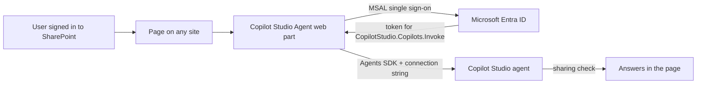

## Before you start

| Need | Details |
|---|---|
| Copilot Studio | Maker access to the environment; Copilot Studio capacity (Copilot Credits) - users do not need a Microsoft 365 Copilot license |
| Microsoft Entra ID | Permission to register an app and grant tenant-wide consent (Cloud Application Administrator or higher) |
| SharePoint | SharePoint Administrator and site admin of the tenant app catalog |
| Workstation | Windows, PowerShell 7, Azure CLI, Node.js 22 (SPFx 1.21.1 needs >= 22.14 < 23) and a clone of this repository |
| Time | About 60-90 minutes the first time. Adding the agent to another site takes about 2 minutes. |

## Part 1 - Prepare the agent in Copilot Studio

### Step 1 - Create a standard-harness agent

*Why:* The Copilot Studio client library (Agents SDK) supports agents built on the standard harness.

1. Copilot Studio > **Home** > **Other ways to build** > **Agent (Standard)**, enter a name, select **Create**.
2. Add a description and instructions on the **Overview** page.

> **Checkpoint:** The agent opens with **Overview**, **Knowledge**, **Topics** and **Channels** tabs.

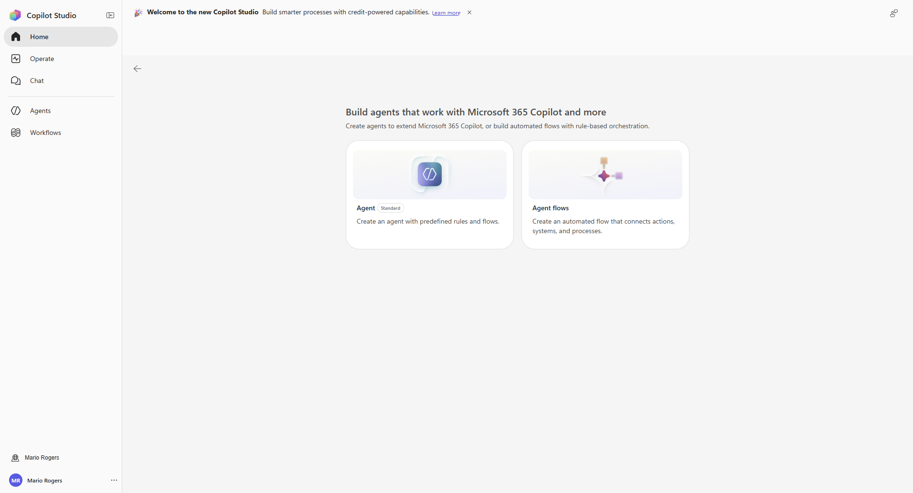
*Home > Other ways to build > Agent (Standard)*

### Step 2 - Require Microsoft sign-in

*Why:* The Agents SDK only works with authenticated agents, and it is what makes the agent know the user.

1. **Settings** > **Security** > **Authentication** > **Authenticate with Microsoft** (default for new agents) > **Save**.

> **Checkpoint:** Channels shows *You're using Microsoft authentication, so only Teams and Microsoft 365 and SharePoint channels are available.*

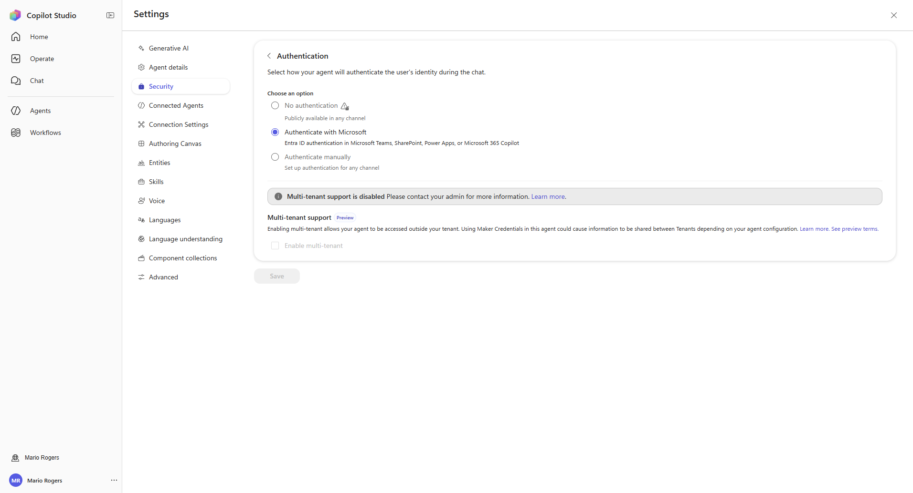
*Settings > Security > Authentication*

### Step 3 - Greet the user by name (recommended)

*Why:* A personalised greeting proves on every page that the user's identity reaches the agent.

1. **Topics** > **System** > **Conversation Start** > **...** > **Open code editor**.
2. Replace only the text of the first message (keep the existing `id`), then **Save**.

```yaml
    text:
      - "Hello {System.User.DisplayName}! I'm {System.Bot.Name}. How can I help?"
```

> **Checkpoint:** The topic saves without errors. After you publish, the greeting shows the signed-in user's name (seen on every test page).

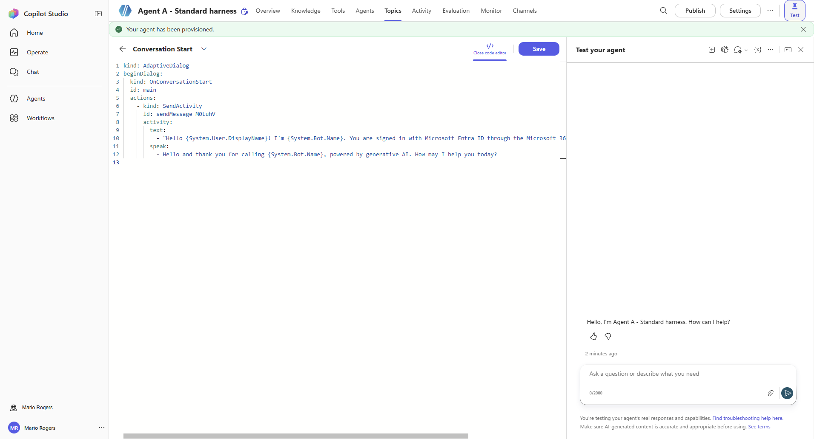
*Conversation Start topic in the code editor*

### Step 4 - Publish and copy the connection string

*Why:* Pages connect to the published agent through this string. It contains no secret.

1. Select **Publish**.
2. **Channels** > **Web app** (or **Native app**) > **Microsoft 365 Agents SDK** > **Copy**.

```text
https://<environment>.environment.api.powerplatform.com/copilotstudio/dataverse-backed/authenticated/bots/<schema-name>/conversations?api-version=2022-03-01-preview
```

> **Checkpoint:** The string ends with `/bots/<agent schema name>/conversations?api-version=...`.

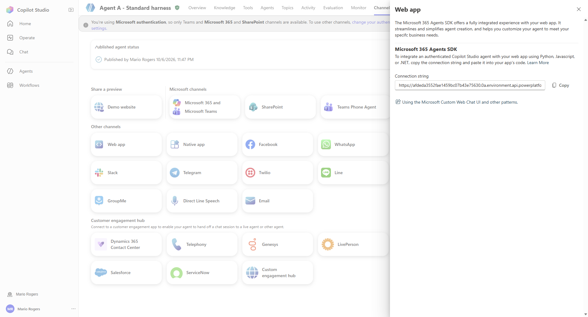
*Channels > Web app > Microsoft 365 Agents SDK*

### Step 5 - Share the agent

*Why:* Sharing decides who can chat - on every site and page.

1. **...** > **Share** > add users or Entra **security groups** > keep **End user access** > **Share**.

> **Checkpoint:** The people or groups appear under **Existing users** as *Viewer*.

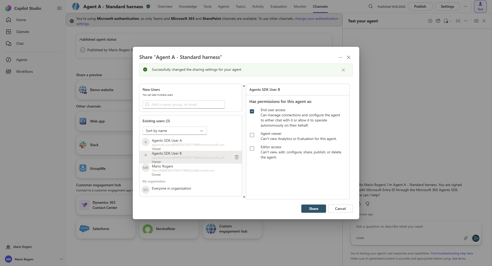
*Share with users or security groups*

## Part 2 - One-time tenant setup

### Step 6 - Register the Entra SPA app

*Why:* SPFx's built-in token provider cannot get the Copilot Studio scope, so the web part signs in with its own app.

1. Copy `scripts/variables.sample.ps1` to `scripts/variables.ps1` and fill it in.
2. Run the script (idempotent). It adds the SPA redirect URI (your SharePoint origin), the delegated **Power Platform API > CopilotStudio.Copilots.Invoke** permission and tenant-wide consent.

```powershell
. .\scripts\variables.ps1
az login --tenant $TenantDomain --allow-no-subscriptions
.\scripts\New-AgentsSdkSpaApp.ps1 -TenantId $TenantDomain -SharePointRootUrl $SharePointRootUrl
```

> **Checkpoint:** The output shows `"adminConsent": "granted"`; note the `appClientId`.

### Step 7 - Build the SharePoint package

*Why:* The package carries the app ID as tenant default, so page authors only paste a connection string.

1. Node 22 is required for SPFx 1.21.1. MSAL, the Agents SDK client and Web Chat are bundled - no CDN or API-access approvals.

```powershell
.\scripts\Build-SpfxPackage.ps1 -AppClientId $AppClientId -Version $PackageVersion -NodePath $Node22Path
# -> spfx-copilot-agent\sharepoint\solution\copilot-studio-agent-webpart.sppkg
```

> **Checkpoint:** `copilot-studio-agent-webpart.sppkg` is created.

### Step 8 - Deploy it to every site

*Why:* One deployment makes the web part available on all current and future sites.

1. SharePoint admin center > **Active sites** > **Apps** > **Membership** > add yourself as **site admin** of the app catalog.
2. App catalog > **Manage apps** > **Upload** the `.sppkg` (**Replace** for updates) > **Enable this app and add it to all sites** > **Enable app**.

> **Checkpoint:** Manage apps lists the package as *Enabled* and *Added to all sites: Yes*.

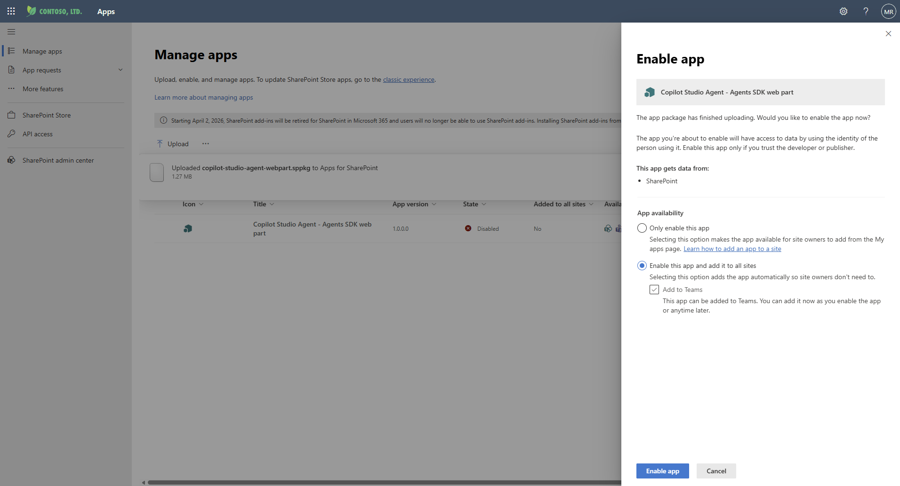
*Enable this app and add it to all sites*

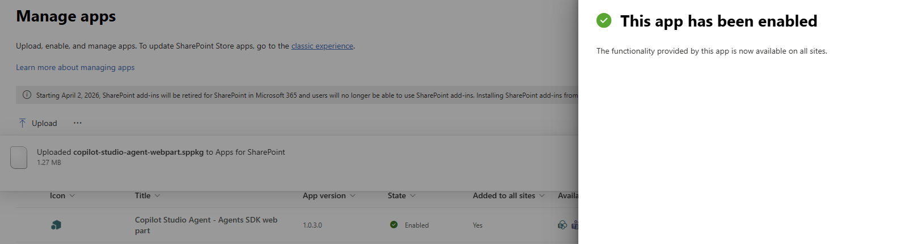
*Version 1.0.3.0 enabled for all sites*

## Part 3 - Add the agent to your sites

### Step 9 - Add the web part and paste the connection string

*Why:* Each page decides which agent it shows; repeat on as many sites as you like.

1. Edit the page > **+** > **Copilot Studio Agent (Agents SDK)**.
2. **Edit properties** > Integration mode **Microsoft 365 Agents SDK** > paste the connection string. Leave app and tenant ID empty (package defaults).
3. **Republish** the page.

> **Checkpoint:** The chat shows your personalised greeting, even in edit mode.

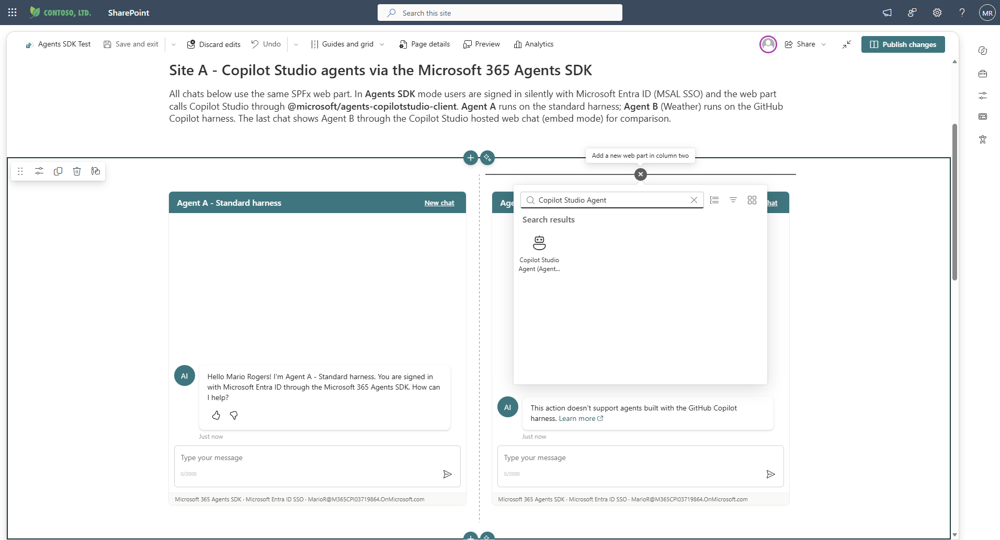
*Toolbox: Copilot Studio Agent (Agents SDK)*

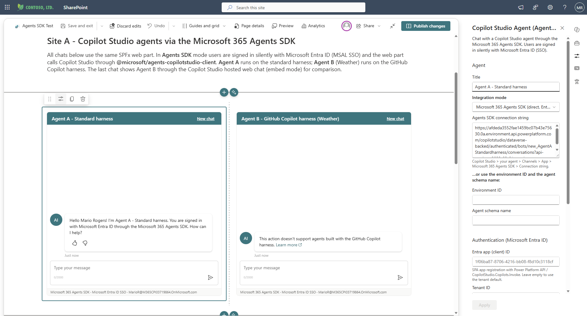
*Property pane: paste the connection string*

### Step 10 - Give people access to the site

*Why:* SharePoint still decides who can open the page. Visitor (Read) is enough.

1. Grant site or page access as usual. Agent sharing and site permissions are independent - people need both.

> **Checkpoint:** A test user opens the page and sees the chat.

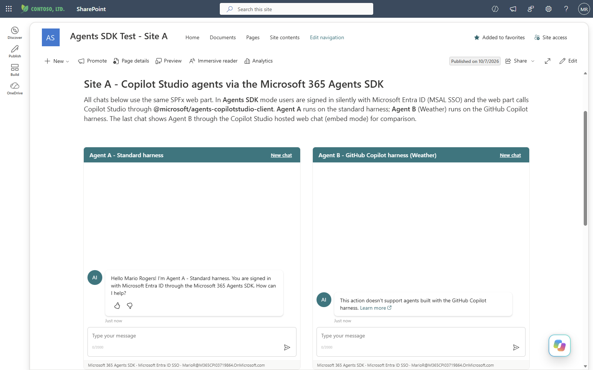
*Published page with two agents*

## Part 4 - Verify

### Step 11 - Run the core test scenarios

*Why:* Five checks prove sign-in, identity, access control and the security boundary.

1. Shared user: greeting by name and an answer (**TC-01**, **TC-02**, **TC-05**).
2. Unshared user: *You don't have access to talk to this bot* (**TC-06**).
3. Anonymous call to the connection string returns HTTP 401 (**TC-04**).

```powershell
Invoke-WebRequest -Method Post -Uri $AgentConnectionString -ContentType 'application/json' `
  -Body '{"emitStartConversationEvent":true}' -SkipHttpErrorCheck | Select-Object StatusCode   # 401
```

> **Checkpoint:** All five results match the expected results in the test scenarios.

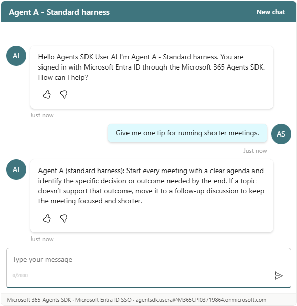
*Shared user: personalised greeting and answer*

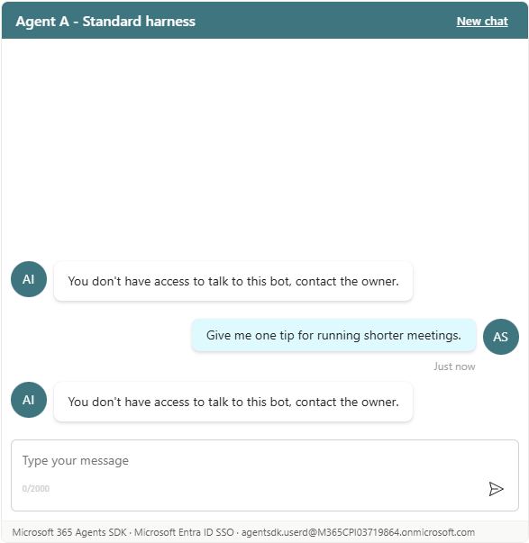
*Unshared user: blocked by Copilot Studio*

### Step 12 - Run the resilience checks

*Why:* Confirms the experience when silent sign-in is blocked, access changes, or a user restarts.

1. Silent sign-in blocked: **Sign in with Microsoft** opens the popup on the first click (**TC-03**).
2. Remove and re-add a user on the agent (**TC-07**, **TC-08**); select **New chat** (**TC-22**).

> **Checkpoint:** The chat connects after one click and access changes apply on the next page load.

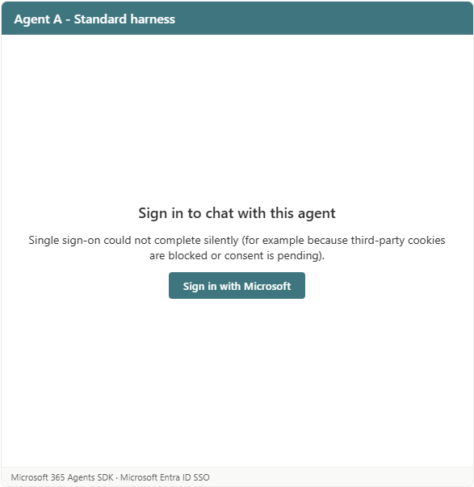
*Silent sign-in blocked: one-click sign-in*

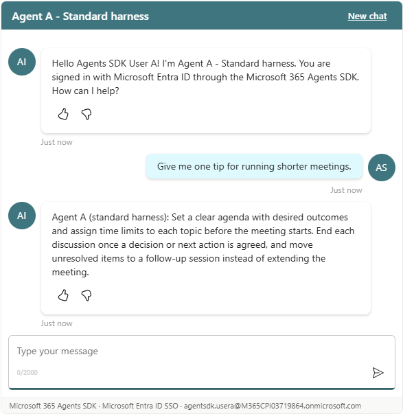
*After the popup: greeting and answer*

### Step 13 - Automate the regression run (optional)

*Why:* Re-run the same scenarios after every agent or package change.

1. Edit `tests/agents-sdk-matrix/settings.py`, then run the harness (Edge + Playwright, one profile per test user).

```powershell
cd tests\agents-sdk-matrix
.\launch-edge.ps1
foreach ($p in 'mario','a','b','c','d') { python run_matrix.py $p }
python run_extra_scenarios.py a A      # TC-03 sign-in fallback + TC-22 New chat
python summarize.py
```

> **Checkpoint:** `output/results/summary.md` shows the expected result for every persona and site.

## Troubleshooting

| What you see | What to do |
|---|---|
| *Sign in to chat with this agent* | Silent sign-on was blocked (third-party cookies, Conditional Access, embedding host). Select **Sign in with Microsoft**. |
| *The sign-in popup was blocked...* | Allow popups for `https://<tenant>.sharepoint.com` and select **Try again**. Package 1.0.2.0+ opens the popup on the first click, also with several agents on a page. |
| *Redirect URI mismatch* (`AADSTS50011`) | Add `https://<tenant>.sharepoint.com` (no trailing slash) as a **Single-page application** redirect URI of the app. |
| *Consent is missing* (`AADSTS65001`) | Grant admin consent for **Power Platform API > CopilotStudio.Copilots.Invoke**. |
| *You don't have access to talk to this bot* | Share the agent with the user or with a security group the user belongs to. |
| *This action doesn't support agents built with the GitHub Copilot harness* | Use an agent built on the standard harness. |
| App catalog: *you need to add yourself as a site admin* | SharePoint admin center > Active sites > Apps > Membership > Site admins. |

## Next

* Run the full set of [test scenarios](Agents-SDK-SharePoint-Use-Cases-and-Test-Scenarios.md#test-scenarios) and record your results in the [test plan](Agents-SDK-SharePoint-Test-Plan.xlsx).
* Background, findings and the comparison with the SharePoint channel + Agent link pattern: [guide](Agents-SDK-SharePoint-Guide.md).
